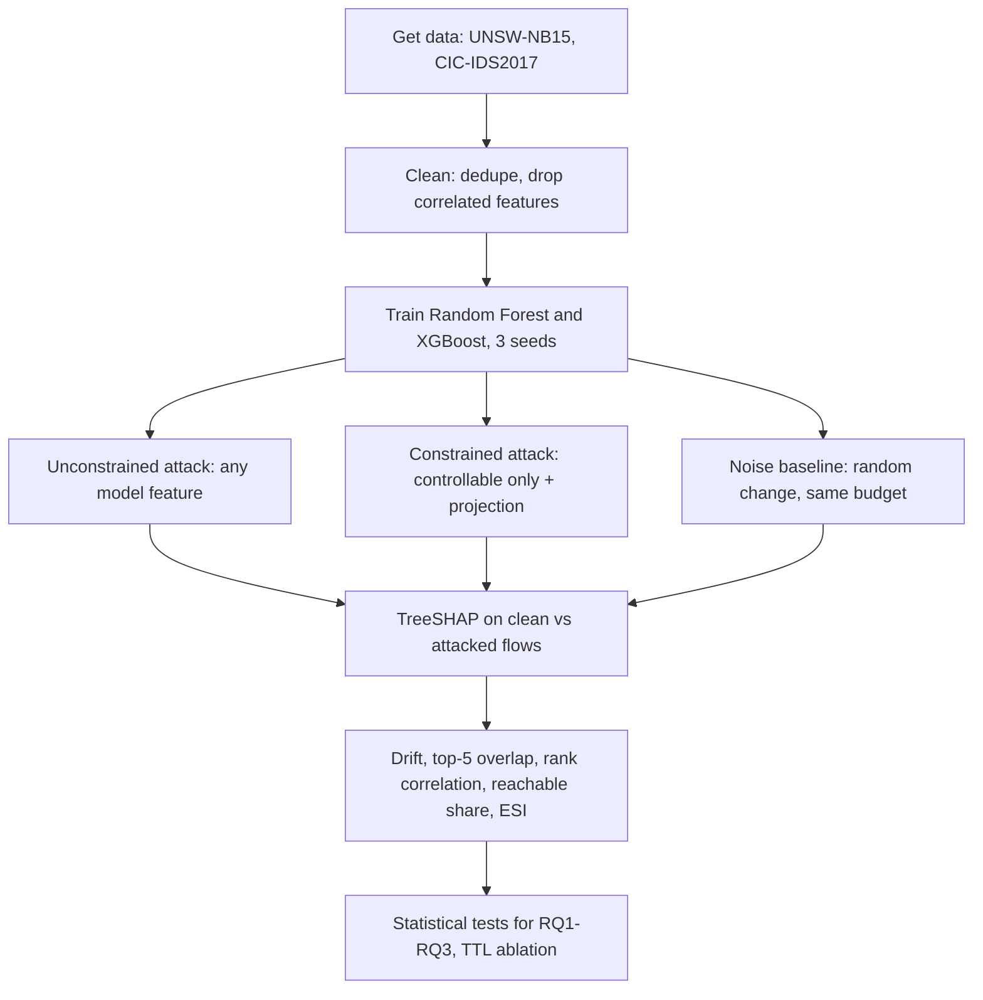

# Do Explanations Survive Realistic Attacks?

**SHAP Stability of Intrusion Detectors Under Constrained vs. Unconstrained Adversarial Perturbations**

Jagadeesh Gopal (School of Computer Science Engineering and Information Systems, Vellore Institute of Technology, Vellore, India · gjagadeesh@vit.ac.in) and Snigda Chandanala (Department of Information Technology, Vellore Institute of Technology, Vellore, India · snigda.chandanala2024@vitstudent.ac.in)

Repository: https://github.com/SnigChan21/realistic-attacks-shap-ids

---

## Contents

1. [The project in one minute](#1-the-project-in-one-minute)
2. [Background for first-time readers](#2-background-for-first-time-readers)
3. [The research question and why it matters](#3-the-research-question-and-why-it-matters)
4. [What we did, in plain words](#4-what-we-did-in-plain-words)
5. [What we found, in plain words](#5-what-we-found-in-plain-words)
6. [Technical details: data](#6-technical-details-data)
7. [Technical details: threat model and features](#7-technical-details-threat-model-and-features)
8. [Technical details: models, attacks, explanations, metrics](#8-technical-details-models-attacks-explanations-metrics)
9. [Detailed results](#9-detailed-results)
10. [What this means in practice](#10-what-this-means-in-practice)
11. [Limitations](#11-limitations)
12. [Repository layout](#12-repository-layout)
13. [How to reproduce everything](#13-how-to-reproduce-everything)
14. [Glossary](#14-glossary)
15. [Frequently asked questions](#15-frequently-asked-questions)
16. [Related work](#16-related-work)
17. [Credits, license and AI disclosure](#17-credits-license-and-ai-disclosure)

---

## 1. The project in one minute

**Non-technical.** Companies use AI systems to spot hackers in their network traffic. When the AI raises an alarm, it can also show *why*: which properties of the traffic made it look suspicious. Security staff rely on these "why" explanations to decide what to do. Earlier research said hackers can easily scramble these explanations. But that research used fake, impossible attacks: it changed the traffic in ways no real hacker could. We tested what happens with *realistic* attacks that only change what a real hacker can actually control. We found that the earlier research **exaggerated** the problem and blamed the wrong things, but also that a **successful** realistic attack still does change the explanation a lot.

**Technical.** We compare TreeSHAP attribution drift of Random Forest and XGBoost intrusion detectors on UNSW-NB15 and CIC-IDS2017 under two versions of the same score-based black-box evasion attack: unconstrained (textbook feature-space $L_\infty$) and constrained (only attacker-controllable features change, with every output projected onto the set of valid flows). Because the search algorithm, budgets, seeds and flows are identical, any difference is caused by realism alone. At equal budget, constrained attacks cause significantly less drift (up to ~50% less), preserve top-5 rankings better and concentrate 81–86% of drift on attacker-reachable features (vs. 35–78%). Conditioned on successful evasion, however, drift magnitudes differ by at most 11% (UNSW-NB15) and 10–20% (CIC-IDS2017). On UNSW-NB15, an attacker-settable shortcut feature (source TTL) drives most of both evasion and drift.

---

## 2. Background for first-time readers

### 2.1 Network traffic and "flows"

When two computers talk over a network, they exchange many small packets. A **flow** is a summary of one conversation: how long it lasted, how many packets and bytes each side sent, packet sizes, timing, flags, and so on. Each flow becomes one row in a table, and each property is a **feature** (a column).

### 2.2 Intrusion detection with machine learning

An **intrusion detection system (IDS)** watches network traffic and raises an alert when something looks like an attack. A **machine-learning IDS** learns from labelled examples of normal and attack flows, then predicts a probability that a new flow is an attack. We use two popular model types:

- **Random Forest**: many decision trees that vote.
- **XGBoost**: decision trees built one after another, each correcting the previous ones.

Both are "tree ensembles", widely used for flow data because they are fast and accurate.

### 2.3 Explanations and SHAP

A prediction alone ("attack, 97%") does not tell an analyst *why*. **SHAP** (SHapley Additive exPlanations) assigns each feature a number showing how much it pushed the prediction towards "attack" (positive) or "normal" (negative). For example: "source TTL pushed this flow strongly towards attack; packet count pushed it slightly towards normal". **TreeSHAP** is the exact, fast version of SHAP for tree models. Analysts use these explanations to judge whether an alert is believable and what to investigate.

### 2.4 Adversarial attacks

An **adversarial (evasion) attack** slightly modifies a malicious flow so the detector calls it normal, while the attack still works. The attacker's **budget** (ε, epsilon) limits how much each feature may change. An attack **evades** if the detector's attack probability drops below 0.5.

### 2.5 Textbook vs. realistic attacks

- **Textbook (unconstrained) attacks** change any feature freely within the budget. Many results come out impossible: negative sizes, average packet sizes that don't match totals, or changes to the *server's* replies, which the attacker cannot control.
- **Realistic (constrained) attacks** change only what the attacker controls (their own packets, timing and header fields), never decrease counts that can only grow, keep values in legal ranges, and recompute dependent features (averages, rates) correctly. Every result is a flow that could really exist.

### 2.6 Explanation drift

**Explanation drift** is how much the SHAP values change between the original flow and its attacked version. Big drift means the explanation the analyst sees after the attack is very different from the true story.

---

## 3. The research question and why it matters

**Question.** *Is the explanation fragility reported for intrusion detectors real, or an artefact of unrealistic attacks?*

**Why it matters.** If attackers can scramble explanations, analysts may dismiss real alerts or chase the wrong clues. Recent papers (e.g. Rajhans and Khawarey, 2026) measured large SHAP drift, but only with textbook attacks, and listed "feature validity" as their own limitation. Another project (FEINT, 2026) showed that realistic constraints dramatically change conclusions about detection **accuracy**, but never measured **explanations**. This project fills that gap.

**Research questions**

| | Question |
| --- | --- |
| RQ1 | At equal budget and at equal evasion rate, do constrained attacks cause less SHAP drift than unconstrained attacks? |
| RQ2 | Under constrained attacks, is drift concentrated on features the attacker can reach? |
| RQ3 | How does drift differ between attacks that evade and attacks that fail? |

**Contributions**

1. The first controlled comparison of explanation drift under constrained and unconstrained versions of the *same* attack on intrusion detectors, with validity checked for every adversarial flow.
2. Evidence on two datasets that textbook attacks overstate explanation fragility at equal budget, mainly because they succeed more often and move features no attacker controls, while successful realistic attacks still cause drift of similar or moderately lower magnitude.
3. Analyst-relevant findings: realistic attacks concentrate drift on attacker-reachable features and generally preserve top-ranked features, yet almost always shift attributions of untouched features through feature interactions ("spill-over").
4. A demonstration that an attacker-settable shortcut feature (source TTL) dominates evasion and drift on UNSW-NB15, and that removing it costs almost no clean accuracy.

---

## 4. What we did, in plain words

1. **Got two well-known datasets** of labelled network traffic (UNSW-NB15 and CIC-IDS2017).
2. **Cleaned them**: removed duplicate rows (about 40% of UNSW-NB15 and 19% of CIC-IDS2017 were repeats) and removed near-duplicate features that would confuse SHAP.
3. **Labelled every feature** as *controllable* (attacker can change it), *fixed* (attacker cannot) or *derived* (calculated from others).
4. **Trained detectors**: Random Forest and XGBoost, three times each with different random seeds.
5. **Attacked them twice** with the same attack algorithm: once freely (textbook) and once following the realism rules, at six budget sizes, on 300 attack flows per model and seed.
6. **Added a control**: random changes of the same size, to separate "the input moved" from "the attacker optimised".
7. **Explained every flow** with TreeSHAP before and after each attack and measured how much the explanation changed.
8. **Ran statistics** to test the three research questions, and an extra check with the TTL feature removed.



---

## 5. What we found, in plain words

1. **Realistic attacks fool the detectors less.** Textbook attacks almost always succeed; realistic ones often fail, especially once the TTL shortcut is removed.
2. **At the same budget, realistic attacks change explanations less**, roughly half as much at small budgets.
3. **But that difference is mostly because textbook attacks succeed more often.** When a realistic attack *does* succeed, the explanation changes almost as much (UNSW-NB15: within 11%; CIC-IDS2017: 10–20% less).
4. **Realistic attacks keep the "top reasons" more intact**, clearly for XGBoost on both datasets and for Random Forest on UNSW-NB15.
5. **Realistic attacks change the explanation mostly where the attacker acted** (81–86% of the change), while textbook attacks spread changes onto server-side features no attacker can touch (only 35–78% on reachable features).
6. **Spill-over:** in almost every realistic attack, features the attacker *never touched* also changed their SHAP values, because trees combine features.
7. **Failed realistic attacks barely change explanations**; successful ones change them a lot.
8. **One shortcut dominates UNSW-NB15**: the source TTL (a header value the attacker sets). Removing it barely affects normal accuracy but makes realistic attacks far weaker and realistic drift much smaller.

**Bottom line:** explanation fragility is real for successful attacks, but textbook attacks exaggerate it and blame features that no attacker controls.

---

## 6. Technical details: data

### 6.1 UNSW-NB15 (Moustafa and Slay, 2015)

| Step | Train | Test |
| --- | --- | --- |
| Official partition (raw) | 175,341 | 82,332 |
| Duplicates removed (within partition) | 76,047 | 29,421 |
| Test rows also present in train (leakage) | – | 1,361 |
| **Clean rows** | **99,294** | **51,550** |
| Attack share | 48.5% | 35.1% |

Flows are mapped onto the 22-feature FEINT schema (base features copied, protocol one-hot for TCP/UDP, derived features recomputed so clean flows obey the same rules as adversarial ones). Duplicates are judged on these features plus the label. 272 training feature vectors have conflicting labels and were kept (reported, not removed).

### 6.2 CIC-IDS2017 (Sharafaldin et al., 2018)

| Step | Count |
| --- | --- |
| Finite rows across the 8 `MachineLearningCSV` day files | 2,830,743 |
| Duplicates removed | 530,897 |
| Rows with conflicting labels removed | 1,656 |
| Stratified sample: 10% per class, min 5,000 per class (smaller classes whole) | – |
| **Train / test (70/30, stratified by attack type, seed 0)** | **177,141 / 75,918** |
| Attack share | 25.7% |

11 CICFlowMeter columns are mapped to the 15-feature FEINT schema (duration converted to seconds; the CIC value −1 for "no window" set to 0; derived features recomputed). Labels are normalised (including the broken dash in "Web Attack"). Classes with fewer than 10 flows after sampling would be dropped (none were).

### 6.3 Correlation control

SHAP splits credit arbitrarily between near-duplicate features, which can create "instability" without any attack (Vourganas and Michala, 2026). For every feature pair with Spearman |ρ| > 0.95 on the training set, one member is dropped (the derived one if possible). Dropped features stay in the constraint schema, so attacks and validity checks always use the full flow.

| Dataset | Dropped | Model features left |
| --- | --- | --- |
| UNSW-NB15 | `dbytes`, `dwin`, `sinpkt`, `proto_tcp`, `proto_udp` | 17 |
| CIC-IDS2017 | `bwd_pkt_len_max`, `mean_iat` | 13 |

### 6.4 Leakage check

The single-feature ROC-AUC (how well one feature alone separates classes) was computed for every feature. Highest: source TTL on UNSW-NB15 (0.87) and duration on CIC-IDS2017 (0.71). No single feature gives the answer away.

---

## 7. Technical details: threat model and features

**Attacker.** Has a malicious flow and wants the detector to call it benign. Has **black-box score access**: can query the detector's attack probability, but cannot see its internals or training data.

**Capabilities on UNSW-NB15** (from the FEINT schema): may increase flow duration (delay packets), add source packets, pad source bytes (each added packet carries at least 40 bytes of headers and at most one MTU, 1,500 bytes), and set source IP TTL to any value in [1, 255] and the source TCP window to any value in [0, 255]. Durations and counts can only increase; counts stay integers. Cannot change server replies, transaction depth, or monitor-computed connection counters. CIC-IDS2017 uses the analogous FEINT schema for client-side counts, sizes, duration and initial window (see `src/schema.py` for exact rules).

**Feature roles**

| UNSW-NB15 role | Features |
| --- | --- |
| Controllable (5) | `dur`, `spkts`, `sbytes`, `sttl`, `swin` |
| Derived (5) | `smean`, `dmean`, `sload`, `dload`, `rate` |
| Fixed (7) | `dpkts`, `dttl`, `trans_depth`, `ct_srv_src`, `ct_dst_ltm`, `ct_src_ltm`, `ct_srv_dst` |

Attacker-**reachable** UNSW-NB15 features (controllable plus derived from controllable) = 9 of 17 (`dmean` is derived only from server-side values, so it is not reachable). A uniform spread of drift would put 53% on reachable features.

| CIC-IDS2017 role | Features |
| --- | --- |
| Controllable (5) | `duration`, `fwd_pkts`, `fwd_bytes`, `fwd_pkt_len_max`, `init_win_fwd` |
| Derived (3) | `fwd_bpp`, `pkt_ratio`, `bytes_per_s` |
| Fixed (5) | `bwd_pkts`, `bwd_bytes`, `syn_count`, `dst_port`, `init_win_bwd` |

All 8 controllable + derived CIC features are reachable (uniform baseline 62%).

A flow is **valid** if it satisfies every rule relative to its original flow. Validity is checked for every adversarial output.

---

## 8. Technical details: models, attacks, explanations, metrics

### 8.1 Detectors

| Model | Settings |
| --- | --- |
| Random Forest | 200 trees, max depth 12, `class_weight="balanced"` |
| XGBoost | 200 trees, max depth 6, learning rate 0.05, subsample 0.8, colsample 0.8 |

Seeds 0, 1, 2 → 12 models per dataset. Trained on raw (unscaled) features; trees are scale-invariant.

### 8.2 Perturbation space

All perturbations are in standardised log space: $z = (\log(1+x) - \mu)/\sigma$, with μ, σ from the training set. Budget ε is an $L_\infty$ radius: each feature may move by at most ε standard deviations of its log value. Grid: ε ∈ {0.1, 0.25, 0.5, 1.0, 1.5, 2.0}.

### 8.3 Attack algorithm (same for both modes)

Score-based black-box random search in the style of Square Attack (Andriushchenko et al., 2020), adapted from FEINT. For 100 iterations, every flow still detected gets a proposal: a random, shrinking subset of the allowed coordinates (from 55% down to 5%) is set to ±ε × {0.25, 0.5, 1.0} around the original; the proposal is kept if it lowers the attack score. The search stops for a flow once it evades.

| Mode | Allowed coordinates | After each step |
| --- | --- | --- |
| Unconstrained | all model features | nothing (untouched features keep exact values) |
| Constrained | the 5 controllable features | projection onto valid flows: monotonicity, ranges, integrality, byte–packet relations; derived features recomputed |

Each model/seed attacks 300 randomly chosen test attack flows that it initially detects correctly.

### 8.4 Noise baseline

One uniformly random perturbation inside the same ε-ball on the same allowed coordinates (projected in constrained mode), with no search. Drift above this baseline is due to adversarial optimisation, not merely moving the input.

### 8.5 Explanations

TreeSHAP, `tree_path_dependent` mode, explaining the attack-class output: **log-odds for XGBoost, probability for Random Forest**. Drift values are therefore compared *within* a model family, never across.

### 8.6 Metrics (per flow; $d_i = |\phi_i(x') - \phi_i(x)|$)

| Metric | Definition | Intuition |
| --- | --- | --- |
| Mean drift $\bar D$ | $\frac{1}{m}\sum_i d_i$ | average change per feature |
| Relative drift | $\sum_i d_i / \sum_i \lvert\phi_i(x)\rvert$ | change relative to original attribution mass |
| Top-5 overlap | share of original top-5 features (by $\lvert\phi\rvert$) still in top 5 | do the main reasons survive? |
| Rank correlation | Spearman between $\lvert\phi(x)\rvert$ and $\lvert\phi(x')\rvert$ | is the whole ranking preserved? |
| Reachable-drift share | $\sum_{i\in R} d_i / \sum_i d_i$ | where does the change go? |
| Fixed-feature drift | mean $d_i$ over features outside $R$ | spill-over onto untouched features |
| ESI | $1 - \frac{1}{\varepsilon_{\max}}\int_0^{\varepsilon_{\max}} \bar D(\varepsilon)/\bar D(\varepsilon_{\max})\,d\varepsilon$ (trapezoid, $\bar D(0)=0$) | shape of the drift curve; 1 = stable, 0 = jumps to max immediately |

Also recorded: evasion, validity, final attack probability, realised $L_\infty$ distance in z-space.

### 8.7 Statistics

- Paired Wilcoxon signed-rank tests (same flow, two modes), Mann–Whitney U for evaded vs. not evaded.
- Effect size: rank-biserial correlation r (−1 to +1).
- Holm–Bonferroni correction across all tests.
- Three ways to compare the two modes fairly: (a) same budget; (b) **success-conditioned**, only flows that evaded under both; (c) **evasion-matched**, each constrained budget paired with the unconstrained budget of closest evasion rate.
- 3 seeds × 300 flows = 900 paired observations per model and budget.

---

## 9. Detailed results

### 9.1 Clean performance (mean of 3 seeds; s.d. ≤ 0.002)

| Dataset | Model | Accuracy | F1 | FPR | ROC-AUC |
| --- | --- | --- | --- | --- | --- |
| UNSW-NB15 | RF | 0.793 | 0.765 | 0.296 | 0.951 |
| UNSW-NB15 | XGB | 0.812 | 0.777 | 0.253 | 0.951 |
| CIC-IDS2017 | RF | 0.996 | 0.993 | 0.004 | 0.9998 |
| CIC-IDS2017 | XGB | 0.996 | 0.992 | 0.004 | 0.9998 |

UNSW-NB15's high false-positive rate is expected: after deduplication, the official test split differs from the training split. Many published papers report ~99% only because duplicates remain.

### 9.2 Validity

100% of constrained outputs are valid flows; 0% of unconstrained outputs are valid, on both datasets.

### 9.3 UNSW-NB15 evasion rate (mean of 3 seeds)

| ε | 0.1 | 0.25 | 0.5 | 1.0 | 1.5 | 2.0 |
| --- | --- | --- | --- | --- | --- | --- |
| RF unconstrained | 0.25 | 0.44 | 0.85 | 1.00 | 1.00 | 1.00 |
| RF constrained | 0.12 | 0.14 | 0.45 | 0.53 | 0.96 | 1.00 |
| XGB unconstrained | 0.67 | 0.82 | 0.92 | 1.00 | 1.00 | 1.00 |
| XGB constrained | 0.52 | 0.55 | 0.59 | 0.60 | 1.00 | 1.00 |

Because packets are whole numbers and derived features are recomputed, constrained flows actually move *more* in realised $L_\infty$ than the nominal budget (e.g. RF, ε = 1.0: 1.40 vs. 0.93 for unconstrained).

### 9.4 UNSW-NB15: RQ1 (drift magnitude)

- **Same budget:** constrained drift is significantly lower for ε ≤ 1.0 (r between −0.71 and −0.96, Holm p < 10⁻⁴). At ε = 1.0, median drift 0.020 vs. 0.033 (RF) and 0.23 vs. 0.33 log-odds (XGB); textbook drift is 30–100% higher for ε ≤ 1.0. The gap closes at ε ≥ 1.5 (n.s. for XGB).
- **Success-conditioned:** among flows evading under both attacks, medians differ by only 0–11% (e.g. RF ε = 1.0: 0.035 vs. 0.035; XGB ε = 1.5: 0.63 vs. 0.66, n.s.).
- **Evasion-matched:**

| Model | ε con / ε unc | Evasion | Drift con. | Drift unc. | Significance |
| --- | --- | --- | --- | --- | --- |
| RF | 0.5 / 0.25 | 0.45 / 0.44 | 0.018 | 0.023 | r = −0.22 |
| RF | 1.0 / 0.25 | 0.53 / 0.44 | 0.020 | 0.023 | n.s. |
| RF | 1.5 / 1.0 | 0.96 / 1.00 | 0.035 | 0.033 | n.s. |
| XGB | 1.0 / 0.1 | 0.60 / 0.67 | 0.231 | 0.256 | r = −0.21 |
| XGB | 1.5 / 1.0 | 1.00 / 1.00 | 0.630 | 0.325 | r = +0.66 |
| XGB | 2.0 / 1.5 | 1.00 / 1.00 | 0.636 | 0.659 | n.s. |

- **Rankings:** top-5 overlap higher under constrained attacks at every budget: 0.78–0.85 vs. 0.67–0.80 (RF) and 0.79–0.83 vs. 0.64–0.74 (XGB), all p < 10⁻⁴.
- **ESI (higher = more gradual):** RF 0.34 ± 0.01 (constrained) vs. 0.20 ± 0.01 (unconstrained); XGB 0.29 ± 0.01 vs. 0.22 ± 0.00. Our unconstrained RF ESI falls in the 0.14–0.29 range reported by Rajhans and Khawarey.
- **Attack vs. noise:** median drift 0.028 vs. 0.006 (RF constrained), 0.031 vs. 0.017 (RF unconstrained), 0.33 vs. 0.10 and 0.34 vs. 0.21 (XGB). The drift is caused by the adversarial search.

### 9.5 UNSW-NB15: RQ2 (where drift goes)

- Median reachable-drift share: **83% (RF) and 86% (XGB) constrained** vs. 65% and 78% unconstrained (r = 0.89, 0.83; uniform baseline 53%).
- Per-feature heatmap (ε = 1.0): source TTL dominates both modes. The unconstrained attack also puts large drift on **destination TTL** (0.63 of max for RF vs. 0.07 constrained), a server-side value no attacker can change.
- **Spill-over:** 99.4% (RF) and 99.6% (XGB) of constrained attacks also shifted attributions of fixed features (median 17% and 14% of total drift).

### 9.6 UNSW-NB15: RQ3 (success vs. failure)

Constrained, ε = 1.0: median drift 0.035 (evaded) vs. 0.008 (not evaded) for RF (r = 0.87); 0.42 vs. 0.15 for XGB (r = 0.65). The gap is smaller under unconstrained attacks (e.g. RF ε = 0.25: 0.030 vs. 0.021, r = 0.42) because they move many features regardless of success.

### 9.7 TTL ablation (UNSW-NB15 without `sttl`, 3 seeds)

| | RF | XGB |
| --- | --- | --- |
| Clean ROC-AUC (with → without TTL) | 0.951 → 0.949 | 0.951 → 0.951 |
| Constrained evasion, all budgets | 2–18% | 6–28% |
| Unconstrained evasion from ε = 1.0 | 100% | 100% |
| Mean drift at ε = 2.0 (con. vs. unc.) | 0.016 vs. 0.048 | 0.16 vs. 0.48 |
| Top-5 overlap (con. vs. unc.) | 0.72–0.90 vs. 0.57–0.78 | |
| Reachable-drift share (unc. / con.; uniform 0.50) | unconstrained 0.30–0.49, constrained 0.62–0.68 | |

Without TTL, textbook attacks shift explanations mainly through features no real attacker controls.

### 9.8 CIC-IDS2017 replication (mean of 3 seeds)

| Model | ε | Unc. evasion | Unc. drift | Unc. top-5 | Con. evasion | Con. drift | Con. top-5 |
| --- | --- | --- | --- | --- | --- | --- | --- |
| RF | 0.1 | 0.97 | 0.048 | 0.71 | 0.30 | 0.028 | 0.72 |
| RF | 0.5 | 1.00 | 0.054 | 0.65 | 0.73 | 0.042 | 0.66 |
| RF | 1.0 | 1.00 | 0.057 | 0.61 | 0.84 | 0.044 | 0.65 |
| XGB | 0.1 | 1.00 | 0.685 | 0.82 | 0.42 | 0.338 | 0.87 |
| XGB | 0.5 | 1.00 | 0.730 | 0.77 | 0.53 | 0.396 | 0.82 |
| XGB | 1.0 | 1.00 | 0.766 | 0.74 | 0.53 | 0.419 | 0.79 |

- Same-budget drift lower under constrained attacks at every budget (RF r −0.63 to −0.78; XGB r −0.84 to −0.88; p < 10⁻⁴).
- ESI: RF 0.13 ± 0.01 vs. 0.07 ± 0.00; XGB 0.24 ± 0.04 vs. 0.10 ± 0.01 (constrained vs. unconstrained).
- Reachable-drift share: 81% (RF) and 84% (XGB) constrained vs. 43% and 35% unconstrained (r = 0.99; uniform 62%).
- Spill-over in 100% of constrained attacks.
- RQ3: e.g. XGB ε = 0.5: 0.52 (evaded) vs. 0.27 (not), r = 0.82.
- **Differences from UNSW-NB15:** success-conditioned constrained drift is still 10–20% lower for ε ≥ 0.5 (e.g. RF ε = 1.0: 0.046 vs. 0.057; XGB 0.55 vs. 0.64). The top-5 advantage is clear for XGB but small or absent for RF (not significant for ε ≤ 0.5). Evasion matching is only possible against ε_unc ∈ {0.1, 0.25} because unconstrained attacks almost always succeed; constrained drift remains lower at these pairs. Unconstrained *noise* moves CIC explanations more than the unconstrained *search*, because the search stops as soon as a flow is misclassified, which happens after very small changes.

### 9.9 Figures (in `results/figures/`, PDF and PNG)

| File | Shows |
| --- | --- |
| `*_fig_drift_vs_eps` | mean SHAP drift vs. budget; solid = attack, dashed = noise; orange = unconstrained, blue = constrained |
| `*_fig_evasion_top5` | evasion rate and top-5 overlap vs. budget |
| `*_fig_top5_box` | top-5 overlap for evaded vs. not evaded flows, per mode |
| `*_fig_reach_share` | share of drift on attacker-reachable features per budget |
| `*_fig_feature_heatmap` | per-feature drift at ε = 1.0, seed 0; (C) controllable, (D) derived |

`*` is `unsw` or `cic`.

---

## 10. What this means in practice

**For security analysts**

- Trust the **ranking** of top features more than raw SHAP magnitudes when an alert might be adversarial.
- A sudden large shift on **client-side** features (TTL, packet/byte counts, timing, window) is a meaningful warning sign of manipulation.
- Do **not** assume that features whose attributions changed are the ones the attacker changed: spill-over moves credit onto untouched features.

**For researchers**

- Report explanation-stability results under **realistic** threat models, or they will overstate fragility and point at features attackers cannot touch.
- Compare attacks at **matched success**, not only matched budget.
- Report results **with and without shortcut features** like UNSW-NB15's TTL.

**For detector builders**

- Avoid relying on attacker-settable header fields such as TTL: removing it cost almost no clean accuracy but made realistic attacks far less effective.

---

## 11. Limitations

- **Feature space only:** constrained flows satisfy the schema rules but were not replayed as real packets; the rules are reasonable assumptions from FEINT, not verified network behaviour.
- **Scope:** two tree-ensemble models, two datasets, one black-box attack algorithm. Neural detectors and gradient-based attacks may behave differently.
- **Budgets are not directly comparable between modes:** integer packet additions and recomputed derived features make realised constrained changes larger than the nominal budget. Success-conditioned and evasion-matched comparisons address this, but the budget grid is coarse.
- **Units:** TreeSHAP values are in probability (RF) and log-odds (XGB), so drift is compared within, not across, model families.
- **Dataset artefacts:** both datasets are lab captures with known issues (e.g. the TTL shortcut), analysed but not fully removable.
- **TreeSHAP mode:** `tree_path_dependent` was used for speed; an interventional cross-check has not yet been run.
- **TTL ablation** uses attack runs only (no noise baseline for seeds 1–2).

---

## 12. Repository layout

```
realistic-attacks-shap-ids/
├── README.md                 this file
├── LICENSE                   MIT (with FEINT attribution)
├── requirements.txt          exact library versions
├── .gitignore                excludes data/, models/, LaTeX build files, checkpoints
├── src/
│   ├── schema.py             feature-constraint schemas for both datasets (from FEINT, MIT)
│   ├── preprocess_unsw.py    UNSW-NB15 cleaning, dedup, correlation filter, feature roles
│   ├── preprocess_cic.py     CIC-IDS2017 cleaning, dedup, sampling, split, correlation filter
│   ├── train.py              Random Forest + XGBoost, 3 seeds, clean metrics, leakage check
│   ├── attack_explain.py     both attacks, noise baseline, TreeSHAP, drift metrics (checkpointed)
│   ├── analyze.py            robustness, drift summary, ESI, statistical tests, figures
│   └── plot_colour.py        re-draws the paper figures in the coloured style used in the paper
├── results/
│   ├── tables/               every number in the paper (see below)
│   └── figures/              all figures (PDF for the paper, PNG for viewing)
```

**Result tables** (prefix `unsw_`, `cic_`, or `unsw_nosttl_`)

| File | Contents |
| --- | --- |
| `*_cleaning_log.json` | every cleaning decision and count, model features and roles |
| `*_single_feature_auc.json` | leakage check |
| `*_clean_performance.csv` / `_per_seed.csv` | Table 9.1 |
| `*_reachability.json` | which model features the attacker can reach |
| `*_per_flow_results.csv.gz` | one row per flow × condition: evasion, validity, all drift metrics |
| `*_per_feature_drift.csv` | mean drift per feature per condition |
| `*_robustness.csv` | evasion, validity, realised L∞ per condition |
| `*_drift_summary.csv` | all metrics, mean ± s.d. over seeds |
| `*_esi.csv` | ESI per model and mode |
| `*_evasion_matched.csv` | evasion-matched pairs |
| `*_stat_tests.csv` | every statistical test with effect size and Holm-adjusted p |
| `*_key_numbers.json` | ESI and spill-over summaries |
| `unsw_featdrift_per_feature_drift.csv` | UNSW per-feature drift (seed 0) for the heatmap |
| `unsw_nosttl_*` | TTL ablation (seed 0 with noise; `_s12` = seeds 1–2; `_all_seeds` merged; `_summary_3seeds.csv`) |

---

## 13. How to reproduce everything

### 13.1 Environment

Python 3.10+ on any laptop (tested on 1 CPU, 4 GB RAM).

```bash
git clone https://github.com/SnigChan21/realistic-attacks-shap-ids.git
cd realistic-attacks-shap-ids
pip install -r requirements.txt
mkdir -p data/processed models
```

### 13.2 Data

| Dataset | Files | Source |
| --- | --- | --- |
| UNSW-NB15 | `UNSW_NB15_training-set.csv`, `UNSW_NB15_testing-set.csv` | https://research.unsw.edu.au/projects/unsw-nb15-dataset |
| CIC-IDS2017 | `MachineLearningCSV.zip` | https://www.unb.ca/cic/datasets/ids-2017.html (short form) |

Put them in one folder, then edit the path at the top of each preprocessing script: `RAW` in `src/preprocess_unsw.py` and `ZIP` in `src/preprocess_cic.py` (they currently point to `/mnt/user-data/uploads`).

### 13.3 Commands

```bash
# UNSW-NB15
python src/preprocess_unsw.py
python src/train.py unsw
python src/attack_explain.py unsw          # ~1 h on one CPU (Random Forest SHAP is the slow part)
python src/analyze.py unsw

# CIC-IDS2017
python src/preprocess_cic.py               # ~3 min
python src/train.py cic
python src/attack_explain.py cic
python src/analyze.py cic

# Per-feature drift for the UNSW heatmap (seed 0, attacks only)
SEEDS=0 KINDS=attack TAG=_featdrift python src/attack_explain.py unsw
python src/analyze.py unsw                 # re-run to draw the heatmap

# Coloured figures exactly as in the paper (after analyze.py)
python src/plot_colour.py unsw
python src/plot_colour.py cic
```

### 13.4 TTL ablation

The ablation reuses the UNSW data with `sttl` removed from the model features. Its cleaning log (`results/tables/unsw_nosttl_cleaning_log.json`) is in the repo; create the data files it expects, then run:

```bash
cp data/processed/unsw_train.csv data/processed/unsw_nosttl_train.csv
cp data/processed/unsw_test.csv  data/processed/unsw_nosttl_test.csv
python src/train.py unsw_nosttl
SEEDS=0 python src/attack_explain.py unsw_nosttl
SEEDS=1,2 KINDS=attack TAG=_s12 python src/attack_explain.py unsw_nosttl
```

Merge and summarise the three seeds:

```python
import pandas as pd
a = pd.read_csv("results/tables/unsw_nosttl_per_flow_results.csv.gz")
b = pd.read_csv("results/tables/unsw_nosttl_s12_per_flow_results.csv.gz")
R = pd.concat([a[a.kind == "attack"], b])
R.to_csv("results/tables/unsw_nosttl_all_seeds_per_flow_results.csv.gz", index=False)
(R.groupby(["model", "mode", "eps", "seed"])
  .agg(ev=("evaded", "mean"), drift=("drift_mean", "mean"),
       t5=("topk_overlap", "mean"), reach=("reach_share", "mean"))
  .groupby(["model", "mode", "eps"]).mean()
  .to_csv("results/tables/unsw_nosttl_summary_3seeds.csv"))
```

### 13.5 Options for `attack_explain.py` (environment variables)

| Variable | Default | Meaning |
| --- | --- | --- |
| `SEEDS` | `0,1,2` | which trained models to attack |
| `EPS` | `0.1,0.25,0.5,1.0,1.5,2.0` | budget grid |
| `KINDS` | `attack,noise` | run the attack, the noise baseline, or both |
| `TAG` | empty | suffix for output file names |

Progress is checkpointed after every (seed, model, mode, ε) condition in `results/tables/chunks/`; re-running the same command resumes where it stopped. Delete that folder to start fresh.

### 13.6 Reproducibility notes

- All randomness is seeded (sampling, splits, models, attacks, noise).
- Library versions are pinned in `requirements.txt`.
- Results may differ in the last decimal across platforms due to floating-point and threading differences in XGBoost.

---

## 14. Glossary

| Term | Meaning |
| --- | --- |
| Flow | summary of one network conversation (one row) |
| Feature | one property of a flow (one column) |
| IDS | intrusion detection system |
| Random Forest / XGBoost | tree-ensemble machine-learning models |
| SHAP / TreeSHAP | method that scores each feature's contribution to a prediction; TreeSHAP is the exact version for trees |
| Attribution | a feature's SHAP value for one flow |
| Explanation drift | change in SHAP values caused by an attack |
| Adversarial / evasion attack | modifying an attack flow so the detector calls it benign |
| Budget (ε) | maximum change per feature, in standard deviations of the log feature |
| Evasion rate | share of attacked flows now called benign |
| Unconstrained (textbook) attack | may change any model feature freely |
| Constrained (realistic) attack | may change only controllable features and must produce a valid flow |
| Controllable / fixed / derived | attacker can change it / cannot / it is calculated from other features |
| Reachable feature | controllable, or derived from a controllable feature |
| Projection | correcting a candidate flow so it obeys all realism rules |
| Valid flow | a flow that satisfies every rule relative to its original |
| Noise baseline | random change of the same size, no optimisation |
| Top-5 overlap | how many of the 5 most important features stay in the top 5 |
| ESI | Explainability Stability Index: shape of the drift-vs-budget curve |
| Spill-over | attribution change on features the attacker did not touch |
| Shortcut feature | a feature that separates classes for an accidental reason (e.g. TTL in UNSW-NB15) |
| Wilcoxon / Mann–Whitney | non-parametric statistical tests for paired / independent samples |
| Rank-biserial r | effect size from −1 to +1 |
| Holm–Bonferroni | correction for running many tests |
| Seed | number fixing randomness so results can be repeated |
| TTL | Time To Live, an IP header field set by the sender |

---

## 15. Frequently asked questions

**Why not use A2PM as the realistic attack?** Comparing A2PM with Square Attack would change two things at once, the algorithm and the constraints. We hold the algorithm fixed so realism is the only difference.

**Why is UNSW-NB15 accuracy only ~80%?** We removed about 40% duplicate rows and cross-split leakage. ROC-AUC of 0.95 shows the models still rank traffic well; the high false-positive rate reflects the known shift between the official train and test splits.

**Why remove correlated features?** Correlated features alone make SHAP unstable. Removing them ensures measured drift comes from the attack.

**Why a noise baseline?** To show drift comes from adversarial optimisation, not just from changing the input.

**Why tree models?** They are standard for flow-based detection, TreeSHAP is exact for them, and they match the main prior work so results are comparable.

**Why can't drift be compared between RF and XGBoost?** Their SHAP values are in different units (probability vs. log-odds).

**What does ε = 1.0 mean?** Each allowed feature may move by about one standard deviation of its log-transformed value.

**Why does realistic evasion jump at ε ≥ 1.5 on UNSW-NB15?** At that budget the attacker can move source TTL into the benign range; without TTL, realistic evasion stays at 2–28%.

**Was AI used?** Yes; see Section 17.

---

## 16. Related work

- Rajhans and Khawarey, *Beyond Gradient-Based Attacks* (arXiv 2607.01679, 2026): main baseline; defines ESI; unconstrained attacks only.
- Rajhans and Khawarey, *Empirical Analysis of Adversarial Robustness and Explainability Drift* (arXiv 2602.06395, 2026).
- Rakshit, *FEINT* (GitHub, 2026): constraint schemas and attack code reused here; showed realism changes accuracy conclusions.
- Vitorino, Oliveira and Praça, *Adaptative Perturbation Patterns (A2PM)*, Future Internet 2022.
- Le, Arifuzzaman and Bao, *TRACE*, Electronics 2026: feasible-perturbation explanation stability for triage.
- Vourganas and Michala, *Stabilising Explainability Fragility in Cybersecurity AI* (arXiv 2605.22529, 2026): multicollinearity and SHAP.
- Maseno, Sun and Wang, *Detecting adversarial evasion in deep learning IDS using explainable AI*, IJIS 2026.
- Munilla and Khammas, *Evaluation of XAI in IoT IDS under DeepFool*, Sensors 2026.
- Apruzzese et al., *Modeling Realistic Adversarial Attacks against NIDS*, DTRAP 2022.
- Pierazzi et al., *Intriguing Properties of Adversarial ML Attacks in the Problem Space*, IEEE S&P 2020.
- Andriushchenko et al., *Square Attack*, ECCV 2020.
- Lundberg and Lee, *SHAP*, NeurIPS 2017; Lundberg et al., *TreeSHAP*, Nature Machine Intelligence 2020.
- Moustafa and Slay, *UNSW-NB15*, MilCIS 2015 and ISJ 2016; Sharafaldin et al., *CIC-IDS2017*, ICISSP 2018.

The full reference list is in the paper.

---

## 17. Credits, license and AI disclosure

- **Authors:** Jagadeesh Gopal, School of Computer Science Engineering and Information Systems, Vellore Institute of Technology, Vellore; Snigda Chandanala, Department of Information Technology, Vellore Institute of Technology, Vellore.
- **Reused code:** constraint schemas and the black-box search are adapted from [FEINT](https://github.com/rakshit-737/feint-adversarial-ids) by Rakshit (MIT License).
- **Datasets:** please cite the original UNSW-NB15 and CIC-IDS2017 papers if you use them.
- **License:** MIT (see `LICENSE`).
- **AI disclosure:** Claude (Anthropic) assisted with coding, running experiments and drafting; the authors verified all results and text.

**Citation** (until the paper is published):

```bibtex
@misc{gopal2026explanations,
  author = {Gopal, Jagadeesh and Chandanala, Snigda},
  title  = {Do Explanations Survive Realistic Attacks? {SHAP} Stability of Intrusion Detectors Under Constrained vs. Unconstrained Adversarial Perturbations},
  year   = {2026},
  howpublished = {\url{https://github.com/SnigChan21/realistic-attacks-shap-ids}}
}
```
